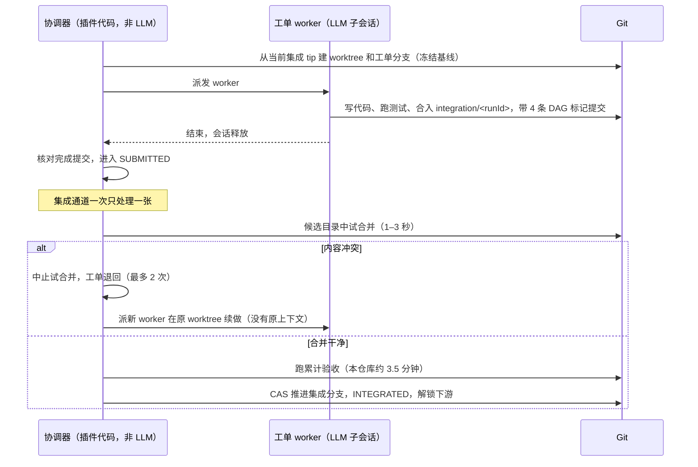

# 集成与验收方式改进方案（待实验）

本文整理 `gh1-fixes-02` 运行期间讨论的方案，供另起会话实现和对比测试。基线为 0.14.0（`c4e90da`）。

## 1. 现状

在 `gh1-fixes-02` 中观察到的问题：

- **集成串行，且每张都跑完整累计验收。** 每张约 3.5 分钟，12 张光排队就超过 40 分钟。其中 `git-tests` 约 150 秒：每个测试都建真实临时仓库，调用 git 一两百次，本机每次约 0.12 秒。
- **冲突由没有上下文的新 worker 解决。**
- **排队不是先进先出。** `_pump` 用 `rows.find` 取清单里排在最前的 SUBMITTED 工单，不是最早提交的。
- **并行建 worktree 偶发失败。** `failed to read .git/worktrees/<other>/commondir`。该错误不在临时错误重试范围内，只能由队长 `dag_retry`。
- **验收失败的通知只截了输出末尾。** 看不出是哪个测试失败。
- **同一提交没有"重新验收"入口。** 遇到偶发失败只能靠空提交加 `dag_retry` 绕过。
- **审查在插件之外。** 审查子智能体不在依赖图里，用户看不到。
- **界面问题：**
  - 依赖图节点不显示尝试次数；
  - 并行数在两个页面叫法不同（“最大 Agent 数量” / “最大并发工单数”），本轮值批准后就看不到；
  - “等待验收”这个说法容易被理解成卡住。

## 2. 方案

| 代号 | 名称 | 集成时做什么 | 难度 |
|---|---|---|---|
| `each` | 现状（对照组） | 每张试合并 + 完整累计验收 | — |
| A | 先合并、最后测 | 只试合并 + 快测试；冲突交回 worker；全部集成后跑一次全量，失败用 `git bisect` 在合并点之间定位到工单，再追加修复工单 | 简单–中等 |
| B | 合并列车 | 排队的 K 个候选按序一起试合并、一次验收；通过则一起发布，失败二分定位 | 最难 |
| E | 验收在 worker 侧 | worker 合入最新集成分支后在自己的 worktree 跑验收并上报；插件核对结果对应当前提交，集成时只跑快测试；集成分支此后又前进时才补跑 | 中等 |
| F | 按改动文件选测试 | 每条验收命令声明负责的文件（glob）；试合并后用 `git diff --name-only` 只跑相关命令；全量兜底 | 简单 |

**快测试**：秒级、不起真实 git 进程的测试。本仓库的 `unit-tests`（store、host、tracker、client-board、dashboard，约 1 秒）属于快测试；`recovery-tests`（约 45 秒）、`git-tests`（约 150 秒）、`coordinator.test.mjs`（数分钟）属于慢测试。

### 组合

| 组合 | 说明 | 难度 |
|---|---|---|
| A + F | 集成时只跑改动相关的快测试，最后全量 | 简单 |
| E + F | worker 侧只跑改动相关的测试 | 简单 |
| A + E + F | worker 跑相关测试；集成只做试合并 + 快测试；最后全量兜底（推荐默认） | 中等 |
| A + B | 互相矛盾，不组合 | — |
| B + F | 收益不值复杂度，不做 | — |

### 与模式无关的开关和改进

1. **冲突交回原 worker 会话**：worker 提交后不销毁会话，保持空闲，不占并发名额，直到工单集成。冲突时用 followup 消息唤醒它，让它带着上下文解决。
   - 前提：先在真实 DSH 上验证空闲子会话能保留、能唤醒、不会被回收。
   - 兜底：派新 worker，把原 worker 的报告和修改摘要放进提示词。
2. **事前避免冲突（D）**：工单声明 `inScope` 文件范围（借鉴 `@nanmicoder/dsh-agent-teams` 的质量门禁契约），队长拆票或插件调度时让文件重叠的工单串行。
3. **集成队列按提交时间先进先出。**
4. **串行执行 `git worktree add`**，或把该类错误归为临时错误自动重试。
5. **验收失败保留完整输出**：存进账本或文件，通知里至少写明失败的测试名。
6. **新增“同一提交重新验收”入口**：例如 `dag_retry({ reverify: true })`。
7. **审查作为工单**：新增 `reviewer` 预设。审查工单依赖全部实现工单，产出 `docs/review/<runId>.md` 提交；修复工单依赖审查工单。开启 `reviewOnComplete` 时由插件自动加上。
8. **界面**：
   - 依赖图节点标注尝试次数（如 ×2），详情列出每次尝试的子会话和原因；
   - 统一并行数的叫法，运行概况显示“本轮最多同时 N 个”；
   - 列表中 SUBMITTED 显示为“验收中 · git-tests 3/3”。

## 3. 实验设计

**一个插件、一个配置项切换模式**，代码同一份才公平，例如 `integrationMode: each | end | train | worker`，外加 `selectChecksByFiles`、`resumeWorkerOnConflict` 两个开关。

**第一层：模拟对比（可重复，几分钟）**

- 用脚本 worker（同 `test/coordinator.test.mjs` 的 launch 夹具）固定一份 8 张工单的任务：
  - 3 组改同一文件；
  - 2 张会产生内容冲突；
  - 1 张“合并干净但逻辑出错”，让某条慢测试失败；
  - 慢测试用可控耗时的假命令模拟（例如固定 30 秒）。
- 对比 7 种配置：`each`、A、B、E、F、A+F、A+E+F。
- 指标：
  - 总耗时；
  - 集成排队时间；
  - 验收命令执行次数；
  - 冲突与重试次数；
  - 逻辑错误在哪个阶段被发现、是否准确定位到工单。

**第二层：真实运行（参考值）**

- 一个小的真实需求（约 6 张工单），同一基线，每种候选模式各跑一次真实 AI。
- 指标：总耗时、冲突与重试次数、token 用量、最终全量测试结果。
- 模型输出有随机性，只作参考。

**实现顺序（按难度）**：F → A → A+F → E → A+E+F → B。B 实现困难时先跳过。

### 实测记录

工具：`benchmarks/`（坦克战役 24 张工单的固定基准、`new-trial.mjs`、`report.mjs`，用法见 `benchmarks/README.md`）。看板从 0.15.2 起显示累计用时。

| 日期 | 模式 | trial | soak | 并发 | 累计用时 | 扣除等待处理 | 工单工作合计 | 集成排队 | 验收 | 验收次数 / 失败 | 冲突 | 尝试 |
|---|---|---|---|---|---|---|---|---|---|---|---|---|
| 2026-11-06 | `each`（现状） | `tank-smoke-01`，基线 `ebb5a27` | 5 秒 | 6 | 1h23m15s | 1h23m02s | 3h34m50s | 1m45s | 3m35s | 48 / 0 | 6 | 31 |

- 这一轮是跑通流程的冒烟轮，soak 只有 5 秒（验收命令里设置 `BENCH_SOAK_SECONDS=5`），不算正式对比。
- 集成排队加验收约 5 分钟，约占总时长 6%，绝大部分时间是 worker 写代码。soak 这么短时，各模式最多只能省这几分钟，会被 AI 输出的波动盖过。
- 下一步：soak 改回 60 秒，再跑一轮 `each` 作为正式基线，看排队和验收的占比是否明显上升；之后再按上面的顺序实现其他模式。
- worker 尝试 31 次，24 张工单中有 7 次是重来（6 次冲突退回，T12 有 1 次报错退出）。减少冲突和失败也是可选的方向。
- 依赖图节点仍不显示尝试次数，多次尝试只计为一个节点（见第 1 节的界面问题）。

## 4. 本轮遗留、未修的审查发现

- T10：队长自己会话里每次轮询仍对每个已接管运行做一次 `peek` 快照，仍为 O(N)；看板 GET 会同步写 `catalog.sqlite` 摘要缓存。
- `src/tracker.mjs` 调用裸 `gh`，未做可信程序解析。
- 测试文件按工单号命名（`t01`、`t07`、`t09`、`t10`），新测试复制了 `until`、`gitRun` 等辅助函数；`ledgerOpens` 和 `readLedger` 只为测试导出；`t07` 测试只断言 README 文本。
- T12：DSH rc.2 / rc.5 真实宿主验收 NOT RUN，需要两个版本的 `DSH_TEST_BIN` 以及 puppeteer-core。
